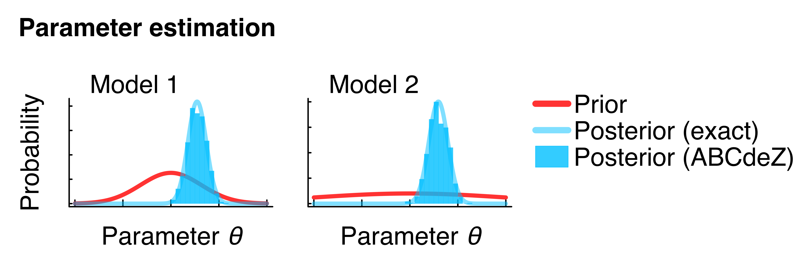
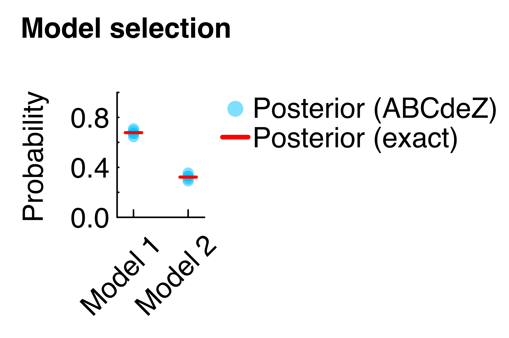

## ABCdeZ.jl

[](https://github.com/mauricelanghinrichs/ABCdeZ.jl/actions/workflows/CI.yml)
[](https://codecov.io/gh/mauricelanghinrichs/ABCdeZ.jl)
[](https://github.com/mauricelanghinrichs/ABCdeZ.jl/actions/workflows/Documentation.yml)
[](https://mauricelanghinrichs.github.io/ABCdeZ.jl/dev/)
[](https://mauricelanghinrichs.github.io/ABCdeZ.jl/stable/)

Approximate Bayesian Computation (**ABC**) with differential evolution (**de**) moves and model evidence (**Z**) estimates.

ABCdeZ.jl offers Bayesian parameter estimation and model comparison/selection for inference problems with an intractable likelihood. Models only need to be simulated (instead of calculating the likelihood). Please visit the documentation ([dev](https://mauricelanghinrichs.github.io/ABCdeZ.jl/dev/)/[stable](https://mauricelanghinrichs.github.io/ABCdeZ.jl/stable/)) to get started.

### Installation

ABCdeZ.jl is a registered Julia package. With a working installation of [Julia](https://julialang.org), install it from the Julia REPL via

```julia
using Pkg
Pkg.add("ABCdeZ")
```

or, equivalently, enter the Pkg REPL by pressing `]` and run `add ABCdeZ`.

### Example



The documentation will go through a minimal example (code also found in `examples` folder above) computing the posterior samples (Figure above) and evidences for two different models. Model evidences can be used to derive posterior model probabilities (Figure below) or Bayes Factors.



### Community guidelines

Contributions, bug reports and questions are welcome:

- **Contribute:** fork the repository, make your changes (with tests and documentation where appropriate) and open a [pull request](https://github.com/mauricelanghinrichs/ABCdeZ.jl/pulls); for larger changes, please open an issue first to discuss them.
- **Report issues:** open an [issue](https://github.com/mauricelanghinrichs/ABCdeZ.jl/issues) with a short description, a minimal reproducing example, the error message (if any) and the package and Julia versions.
- **Seek support:** open an [issue](https://github.com/mauricelanghinrichs/ABCdeZ.jl/issues) describing what you are trying to achieve.

See the [documentation](https://mauricelanghinrichs.github.io/ABCdeZ.jl/dev/#Community-guidelines) for more details.

### Authors

ABCdeZ.jl was developed [@TSB](https://www.dkfz.de/en/theoretical-systems-biology) by [Maurice Langhinrichs](mailto:m.langhinrichs@icloud.com) and Nils Becker. Some part of the code base was adapted from [KissABC.jl](https://github.com/francescoalemanno/KissABC.jl); please visit the documentation for a complete list of references.